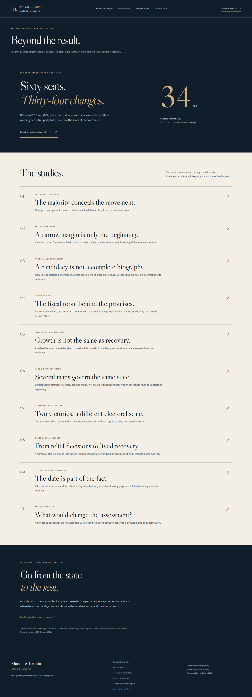
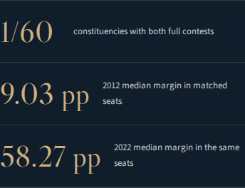

# Research expansion · verification record

Application revision: `6fbff4596a5e6a5d3797adc39c988f4a4fb79f62`.

[GitHub Actions build, browser QA, PDF verification and deployment](https://github.com/ethereum007/manipur/actions/runs/39248306331).

- 8 data/calculation tests passed, including seat-flow conservation, incomplete-coverage guards, paired-sample identity and competition denominators.
- 10 browser tests passed, including all ten research studies, election-lab controls, CSV download, constituency notes, desktop/mobile overflow checks and existing core journeys.
- Five-page executive briefing PDF passed its document checks.
- Desktop and mobile screenshots reviewed for research desk, fiscal longform, election lab and constituency detail.
- Corrected mobile percentage-point wrapping, related-link spacing, wide-table scroll cues and oversized source-note text. Added keyboard-focusable table regions.

## Primary-source review

Economic Survey 2024–25: PDF pp.55,57,59 visually reviewed for nominal GSDP, constant-price growth, GSVA composition and per capita income.

FRBM 2026–27: PDF pp.3–4 visually reviewed for debt-ratio targets and growth assumptions.

CAG 2023–24: PDF pp.14,18,121 visually reviewed for committed/inflexible spending, outstanding utilisation certificates and the recurring/non-recurring grant qualification.

Source checksums and acquisition status: [dossier-source-review.json](../../data/research/dossier-source-review.json). The original NEC constitutional-source certificate failure is preserved; the published study links an official Legislative Department alternate at PDF p.529 / printed p.236.

## Remaining evidence gaps

All sixty winner records are available in each Assembly year. Full candidate-vote contests remain 1/60 in 2012, 58/60 in 2017 and 37/60 in 2022. Rankings and paired medians describe their stated samples. General affidavit transcription, parliamentary segment reconciliation, current boundary crosswalks and local service-delivery verification remain incomplete and explicitly marked.

All new authoring was committed through GitHub APIs; builds, source extraction, screenshots and document checks ran on GitHub Actions.
